# Architecture and trust boundaries

```mermaid
flowchart LR
 O["Owner<br/>mobile web"] --> A["Local HTTP API<br/>consent and session scope"]
 A -. "needs consent" .-> I["Google Gemini<br/>discovery and product proposal"]
 I --> R["Local catalogue rules<br/>price and eligibility validation"]
 R --> C[("25 products")]
 A --> V["On-device OCR<br/>evidence checks"]
 V --> G[("Synthetic registries")]
 R --> D[("SQLite workspace<br/>orders and handoffs")]
 V --> D
 D --> P["Partner review<br/>notes and transitions"]
 P --> T["Owner tracker<br/>recorded milestones"]
 classDef base fill:#f8f5ff,stroke:#7760bd,color:#28233c,stroke-width:1.5px
 classDef external fill:#fff5f4,stroke:#c70022,color:#502333,stroke-width:1.5px
 class O,A,R,C,V,G,D,P,T base
 class I external
```

## Decisioning
- Recommendations consider the declared goals, employee/site/device counts, tier and tax-inclusive recurring budget. One connection per site is enforced for primary connectivity.
- Services requiring GST can be explored provisionally if the owner declares a GSTIN. Checkout requires an active verified GST record for those products. Udyam does not substitute for product-specific GST requirements.
- Dependencies are validated on every edit and at reservation. Monthly and setup taxes are recomputed server-side. The first invoice estimate includes both.
- The first essential service may exceed an infeasible budget; the gap is explicitly returned. Further services are deferred with a reason. No savings or availability are invented.

## KYC
Gemini needs discovery and product proposals require separate AI consent. A local pass reconciles explicitly stated counts and budget, and preserves negations when reconciling goals. A required per-goal proposal schema prevents silent omission. Profile schemas allow sizing/goals/current-tool categories only. Common identifiers are redacted from the current chat message. No documents or stored registry records reach Gemini. Proposed products are filtered to requested goals, quantities must cover declared users/devices, and the server calculates all prices and eligibility. Provider errors are explicit and do not silently switch an AI-labelled plan to rules.

The native adapter uses Apple Vision, with a dark-text pass and text-line baseline correction for rotated images. Linux/Windows can use Tesseract. Extraction reads file contents, not scenario filenames. Checks include registry state, certificate/registry identifier consistency, business-name overlap, principal-address similarity/postcodes, address-proof age and signatory expiry. OCR uncertainty escalates rather than auto-approving. This is not a document authenticity engine.

## Persistence and lifecycle
A random HttpOnly / SameSite=Strict cookie scopes each browser workspace. APIs require same-origin JSON for mutations. Order fetches and transitions are scoped to the owning session. Identifiers are hashed/masked; request logging is disabled. Uploads are temporary. Session inactivity expiry is checked on incoming workspace requests and startup. Deletion cascades to orders and handoffs.

Reservation recalculates the quote and has an idempotency key. No payment is collected. Partner transitions require an audit note. Verification approval requires consent, matching order registration and clear document checks. Scheduling requires a valid date. Activation is a deliberate simulated-provider action, never an elapsed-time animation.

## Production gap
Add authenticated customer/partner roles, encrypted storage and managed keys, real document-authenticity and telecom KYC review, malware scanning, rate limits, serviceability adapters, durable job queues, signed provider webhooks, real payment/e-sign integrations, production consent/retention/backup-erasure policies, monitoring and legal review. Loopback-only deployment and session isolation do not replace production authentication.
